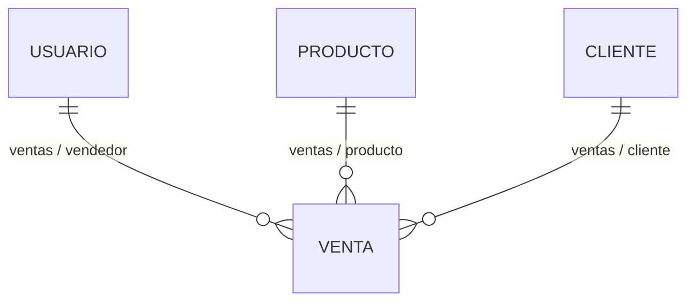

# Expediente del trabajo: Ventas (Grupo A)

## 1. Integrantes y caso

| | |
|---|---|
| Integrante | Oscar Olano (oscarjscom) |
| Grupo | A · Caso Ventas |
| App | Ventas (UIKit + Storyboard + Core Data) |
| Roles | Vendedor y Supervisor |

## 2. Modelo de datos

| Entidad | Atributos | Relaciones y regla de borrado |
|---|---|---|
| Usuario | nombre, usuario, clave, rol (String: Vendedor o Supervisor) | ventas: To Many → Venta, **Deny** |
| Producto | nombre, categoria (String), precio (Double), stock (Integer 64) | ventas: To Many → Venta, **Deny** |
| Cliente | nombre, documento (String) | ventas: To Many → Venta, **Deny** |
| Venta | fecha (Date), cantidad (Integer 64), precioUnitario, descuento, igv, total (Double), anulada (Boolean), motivoAnulacion (String, opcional) | vendedor: To One → Usuario; producto: To One → Producto; cliente: To One → Cliente (Nullify, con su inversa) |

Con **Deny**, Core Data no deja borrar un usuario, producto o cliente que tenga ventas. La app lo revisa antes y muestra una alerta.

## 3. Roles y permisos

| Qué puede hacer | Vendedor | Supervisor |
|---|---|---|
| Pestañas | Productos, Clientes, Venta, Mis ventas, Cuenta | Resumen, Ventas, Productos, Clientes, Cuenta |
| Productos | Solo consultar y buscar | Crear, editar y borrar |
| Clientes | Crear, editar y consultar | Crear, editar, consultar y borrar |
| Ventas | Registrar y ver solo las suyas | Ver todas, filtrar por vendedor y anular con motivo |
| Resumen | No lo ve | Indicadores, gráfico de 7 días y ranking |

## 4. Reglas de negocio con ejemplos

| Regla | Ejemplo resuelto |
|---|---|
| Categoría del cliente (calculada con las ventas no anuladas, no se guarda) | Comprado S/ 999.99 → Regular · S/ 1,000.00 → Frecuente · S/ 5,000.00 → VIP |
| Descuento: VIP 10% del subtotal, los demás 0% | 2 Laptop × S/ 200.00 = 400.00 · descuento 10% = 40.00 |
| IGV: 18% sobre (subtotal − descuento) | (400.00 − 40.00) × 18% = 64.80 |
| Total = subtotal − descuento + IGV | 400.00 − 40.00 + 64.80 = **424.80** |
| Cliente Regular | 3 Mouse × 35.00 = 105.00 · IGV 18.90 · total **123.90** |
| Stock: al vender baja; si la cantidad supera el stock, alerta y no se registra | Laptop 40 → venta de 2 → 38. Venta de 50 con stock 40 → alerta, el stock sigue en 40 |
| Anular (solo supervisor): exige motivo, devuelve el stock y deja de contar | Anular la venta de 424.80 → Laptop vuelve a 40 y el resumen baja 424.80 |
| Visibilidad | El vendedor ve sus ventas con el predicate `vendedor == usuario de la sesión` |

Cada monto se redondea a 2 decimales.

## 5. Pantallas

| Pant. | Pantalla | Lee o escribe |
|---|---|---|
| A1 | Login | Lee Usuario (usuario sin distinguir mayúsculas y clave) |
| A2 | Crear cuenta | Escribe Usuario (revisa que el usuario sea único) |
| A3 | Productos | Lee Producto con chips de categoría y búsqueda (predicates). El supervisor crea, edita y borra |
| A4 | Clientes | Lee Cliente y sus ventas para el total comprado y la categoría. Crea y edita; el supervisor borra |
| A5 | Nueva venta | Escribe Venta y baja el stock del Producto |
| A6 | Mis ventas | Lee las ventas del vendedor de la sesión, filtradas por Todas, Hoy o Mes y por cliente |
| A7 | Ventas del equipo | Lee todas las ventas con chips por vendedor (relación venta ▸ vendedor) |
| A8 | Anular venta | Escribe anulada y motivoAnulacion, y devuelve el stock |
| A9 | Resumen | Fetch requests: vendido hoy y ayer, IGV del mes, 7 días, ranking del mes y stock bajo |
| — | Cuenta | Muestra nombre, usuario y rol, y cierra la sesión |

## 6. Casos de prueba

| N.º | Caso | Resultado esperado |
|---|---|---|
| 1 | Registrar "lparedes" como Supervisor e intentar otro "LPAREDES" | El primero entra; el segundo se rechaza por usuario repetido |
| 2 | Registrar con claves distintas o de 4 caracteres | Mensaje de error; no se crea el usuario |
| 3 | Login con clave incorrecta | "Usuario o clave incorrectos"; no entra |
| 4 | Vendedor vende 2 Laptop a S/ 200.00 a un cliente VIP | Subtotal 400.00 · descuento 40.00 · IGV 64.80 · total 424.80 · stock 40 a 38 |
| 5 | Vendedor vende 3 Mouse de S/ 35.00 a un cliente Regular | Subtotal 105.00 · IGV 18.90 · total 123.90 |
| 6 | Venta de 50 unidades con stock 40 | Alerta y no se registra; el stock no cambia |
| 7 | Un vendedor abre Mis ventas | Solo sus ventas y ninguna fila permite anular |
| 8 | El supervisor anula la venta del caso 4 sin motivo y luego con motivo | Sin motivo el botón Anular está deshabilitado; con motivo queda anulada, el stock vuelve a 40 y el resumen baja 424.80 |
| 9 | Borrar un cliente que tiene ventas | Se impide y se muestra un mensaje |
| 10 | (propio) Un vendedor entra a Productos | No ve el botón + ni puede deslizar para borrar |
| 11 | (propio) María Quispe (Frecuente, S/ 1,062.00) compra 1 Monitor de S/ 450.00 | Sin descuento · IGV 81.00 · total 531.00 · pasa a S/ 1,593.00 y sigue Frecuente |

## 7. Plan de commits

| Commit | Contenido |
|---|---|
| 1 | Expediente |
| 2 | Modelo Core Data con las cuatro entidades y datos de ejemplo |
| 3 | A1 Login, sesión, pestañas por rol y Cuenta |
| 4 | A2 Crear cuenta |
| 5 | A3 Productos |
| 6 | A4 Clientes |
| 7 | A5 Nueva venta |
| 8 | A6 Mis ventas |
| 9 | A7 y A8 Ventas del equipo y anulación |
| 10 | A9 Resumen del supervisor |
| 11 | Ícono, nombre de la app y README |

## 8. Plan de uso de IA

- **A mano:** el modelo de datos, la matriz de permisos, las reglas con sus ejemplos y los casos de prueba de este expediente.
- **Con IA:** armar el Storyboard (escenas, constraints y conexiones) y el código de cada pantalla siguiendo este expediente.
- **Cómo se verifica:** los 11 casos de prueba en el simulador, revisando cada monto contra la sección 4. Cada consulta se anota en `PROMPTS.md`.

## 9. Visto bueno

| Fecha | Confirmación del docente |
|---|---|
| | Pendiente |
